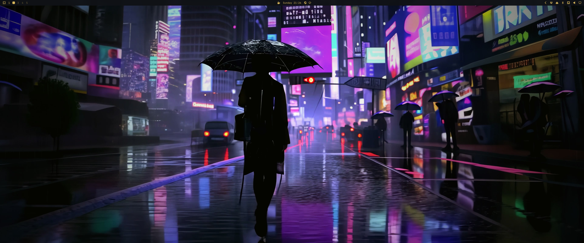

# Rundfunk

**A dark Japanese cyberpunk Omarchy theme — graphite surfaces, restrained neon accents, and cinematic Tokyo-night wallpapers.**

**Author:** J.P. Ramackers  
**License:** [MIT](LICENSE) for project code/configuration. Wallpaper videos are sourced from Pixabay and other media platforms (see [ASSETS.md](ASSETS.md)).  
**Omarchy compatibility:** Designed for **Omarchy 4.5** (verified against local 4.5 theme conventions). Future 4.6+ compatibility is considered but not runtime-verified.




## Quick install

Install directly from this repository using Omarchy's native theme installer:

```bash
omarchy-theme-install https://github.com/vlaktaks/rundfunk.git
```

`omarchy-theme-install` clones the theme into `~/.config/omarchy/themes/rundfunk` and applies it. This is the supported, standard Git-based installation path for Rundfunk.

> **Omarchy 4.5 note (git-installed themes):** when a theme is installed from a Git repository, Omarchy 4.5 stages theme files selectively and does not use executable Lua files or certain bundled terminal/VS Code config files from repo-installed themes (`*.lua`, `alacritty.toml`, `foot.ini`, `ghostty.conf`, `kitty.conf`, `vscode.json`). Rundfunk therefore ships only supported theme mechanisms: `colors.toml` and `shell.toml` tokens/templates, backgrounds and native intros, icons, keyboard color, preview/unlock assets, and Omarchy-generated themed configs. Do not modify internal Omarchy scripts or disable Omarchy protections.

## Features

- **Dark graphite/charcoal base** with restrained neon accents (cyan, red, magenta) — not purple-heavy.
- **Sixteen bundled 4K static wallpapers** (`backgrounds/*.jpg`, 3840×2160) selectable through Omarchy's normal wallpaper mechanism (three previously included pairs removed after owner testing).
- **Native theme-switch intro animations:** matching one-time reveal videos in `backgrounds/intros/*.mp4` (same filename stems) for Omarchy 4.5's native intro flow. Intros play once on eligible theme-switch events, resolve into the corresponding static wallpaper, and stop (no continuously animated desktop wallpapers).
- **Window and theme borders:** uniform **1px** borders (where natively configurable), with Rundfunk gold `#D6B45A` applied to relevant active/inactive window-border and shell surface/menu border tokens via supported theme-scoped configuration (`colors.toml`, `shell.toml` including explicit `border-width = 1`) where supported.
- **JetBrainsMono Nerd Font** preferred in supported terminal/editor theme outputs.
- **Keyboard backlight:** subtle cyan (`keyboard.rgb`).
- **Icons:** `Yaru-magenta` (installed by Omarchy by default).
- **Top bar:** preserves existing Omarchy bar layout/widgets/behavior; Rundfunk applies a theme-scoped gold bar text treatment (`#D6B45A` via `shell.toml [bar].text`) and gold-themed shell border tokens only while Rundfunk is active. Native Omarchy bar application/window indicators do not expose a separate per-indicator border setting beyond supported themed tokens; menu/popup/notification/launcher/polkit/lock surface borders are explicitly configured to 1px gold in Rundfunk `shell.toml` (visual verification not performed).
- **Unlock/preview assets:** `preview.png` (root README preview) and `preview-unlock.png` (unlock/lock-screen preview, faithful copy of the confirmed preview for Omarchy's native asset convention), plus `unlock.png`.

## Wallpaper and intro combinations

| Wallpaper (`backgrounds/`) | Intro (`backgrounds/intros/`) | Description |
| --- | --- | --- |
| `1-sunset-river-valley.jpg` | `1-sunset-river-valley.mp4` | Cinematic sunset river valley composition |
| `3-pumpkin-smoke-night.jpg` | `3-pumpkin-smoke-night.mp4` | Dark pumpkin/smoke night composition |
| `4-ocean-horizon-waves.jpg` | `4-ocean-horizon-waves.mp4` | Cinematic ocean horizon waves composition |
| `5-daemon-sliced-veil.jpg` | `5-daemon-sliced-veil.mp4` | Dark dramatic daemon sliced-veil composition |
| `6-neon-heartbeat-pulse.jpg` | `6-neon-heartbeat-pulse.mp4` | Neon heartbeat pulse composition |
| `7-obsidian-nocturne.jpg` | `7-obsidian-nocturne.mp4` | Dark cinematic nocturne composition (from user-supplied 7th source) |
| `8-ember-cascade.jpg` | `8-ember-cascade.mp4` | Cinematic ember-toned composition (from extra source `151223-800210508.mp4`) |
| `9-amber-drift.jpg` | `9-amber-drift.mp4` | Cinematic amber-toned composition (from extra source `151228-800210517.mp4`) |
| `10-abyssal-current.jpg` | `10-abyssal-current.mp4` | Deep cyan/abyssal motion composition (from extra source `183264-870441862.mp4`) |
| `11-cobalt-lumina.jpg` | `11-cobalt-lumina.mp4` | Cobalt-toned luminous composition (from extra source `352484.mp4`) |
| `12-gilded-mist.jpg` | `12-gilded-mist.mp4` | Gilded mist composition (from extra source `85903-590437612.mp4`, provisional name) |
| `15-luminous-drift.jpg` | `15-luminous-drift.mp4` | Luminous drift composition (from extra source `263040.mp4`, provisional name) |
| `16-ember-haze.jpg` | `16-ember-haze.mp4` | Ember haze composition (from extra source `265688.mp4`, provisional name) — **preferred default for fresh installs** (native fallback behavior noted in limitations) |
| `17-neon-canopy.jpg` | `17-neon-canopy.mp4` | Neon canopy composition (from extra source `329126.mp4`, provisional name) |
| `18-midnight-campfire.jpg` | `18-midnight-campfire.mp4` | Midnight campfire composition (from extra source `lofi-camping-night-live-wallpaper-wallsflow-com.mp4`, provisional name) |
| `19-crimson-reverie.jpg` | `19-crimson-reverie.mp4` | Crimson reverie composition (from extra source `samurai-girl-oni-mask.mp4`, provisional name) |

**Removed after owner testing:** `2-sunset-palm-road` (`51587-465226632.mp4`), `13-velvet-horizon` (`188528-883127082.mp4`), `14-aurora-veil` (`202495-918066643.mp4`). Remaining wallpapers were not renumbered.

Select wallpapers using Omarchy's normal wallpaper controls. Each wallpaper has a matching native intro reveal in `backgrounds/intros/` with the same filename stem.

## Theme-switch intro animations

Rundfunk uses Omarchy 4.5's native background intro mechanism: static wallpapers in `backgrounds/` with matching one-time reveal videos in `backgrounds/intros/<wallpaper-stem>.mp4`. When conditions allow (animations enabled, background intros enabled, eligible theme-switch/background-intro events, correct selection/state), Omarchy resolves and plays the matching intro and then settles on the corresponding static wallpaper.

- **One-time only:** intros are short reveal animations, not looping/continuous desktop videos.
- **Final frame handoff:** each intro is authored to end on the same composition as its matching static wallpaper.
- **Verification:** native resolver and OWE playback execution/completion were evidenced in controlled theme-switch tests for all sixteen remaining pairs, but actual on-screen visibility and seamless handoff require owner visual confirmation.

## Installation, updates, switching, and removal

### Standard installation

```bash
omarchy-theme-install https://github.com/vlaktaks/rundfunk.git
```

This clones Rundfunk into `~/.config/omarchy/themes/rundfunk` as a Git-installed extra theme and applies it.

### Updating Rundfunk (native Omarchy workflow)

Omarchy 4.5 treats **extra-theme updates** separately from the main system update:

- **System update:** `omarchy update` (or `omarchy up`) updates Omarchy/system packages and related Omarchy-managed components; it does **not** update user-installed extra themes.
- **Extra themes update:** run `omarchy-theme-update`, or use the Omarchy menu action **Update → Extra Themes** (shown when extra themes are installed). This runs `git pull` in each user-installed Git theme directory discovered by Omarchy (`~/.config/omarchy/themes/*` that is a real directory with a `.git` directory).

```bash
omarchy-theme-update
omarchy theme set rundfunk
```

**Local modifications/conflicts:** because updates use `git pull`, local uncommitted changes, modified tracked files, or divergent history in the installed theme directory can cause the update to fail or require manual Git resolution. Avoid editing files inside `~/.config/omarchy/themes/rundfunk` directly if you want smooth updates. If an update fails, inspect safely:

```bash
git -C ~/.config/omarchy/themes/rundfunk status
git -C ~/.config/omarchy/themes/rundfunk remote -v
git -C ~/.config/omarchy/themes/rundfunk branch -vv
```

If you need a clean reinstall from the published remote state, switch to another theme first and reinstall:

```bash
omarchy theme set tokyo-night
omarchy-theme-install https://github.com/vlaktaks/rundfunk.git
```

### Switching themes and wallpapers

- **Check current theme:** `cat ~/.local/state/omarchy/current/theme.name`
- **List themes:** `omarchy-theme-list`
- **Switch to Rundfunk:** `omarchy theme set rundfunk`
- **Switch to another theme:** `omarchy theme set <theme-name>` (e.g. `omarchy theme set catppuccin`)
- **Check current wallpaper:** `readlink -f ~/.local/state/omarchy/current/background`
- **Cycle wallpaper:** `omarchy-theme-bg-next`
- **Select wallpaper via menu:** Omarchy menu → Appearance → **Background**.
- **Set a specific Rundfunk wallpaper:**

```bash
omarchy-theme-bg-set ~/.local/state/omarchy/current/theme/backgrounds/1-sunset-river-valley.jpg
omarchy-theme-bg-set ~/.local/state/omarchy/current/theme/backgrounds/3-pumpkin-smoke-night.jpg
omarchy-theme-bg-set ~/.local/state/omarchy/current/theme/backgrounds/4-ocean-horizon-waves.jpg
omarchy-theme-bg-set ~/.local/state/omarchy/current/theme/backgrounds/5-daemon-sliced-veil.jpg
omarchy-theme-bg-set ~/.local/state/omarchy/current/theme/backgrounds/6-neon-heartbeat-pulse.jpg
omarchy-theme-bg-set ~/.local/state/omarchy/current/theme/backgrounds/7-obsidian-nocturne.jpg
omarchy-theme-bg-set ~/.local/state/omarchy/current/theme/backgrounds/8-ember-cascade.jpg
omarchy-theme-bg-set ~/.local/state/omarchy/current/theme/backgrounds/9-amber-drift.jpg
omarchy-theme-bg-set ~/.local/state/omarchy/current/theme/backgrounds/10-abyssal-current.jpg
omarchy-theme-bg-set ~/.local/state/omarchy/current/theme/backgrounds/11-cobalt-lumina.jpg
omarchy-theme-bg-set ~/.local/state/omarchy/current/theme/backgrounds/12-gilded-mist.jpg
omarchy-theme-bg-set ~/.local/state/omarchy/current/theme/backgrounds/15-luminous-drift.jpg
omarchy-theme-bg-set ~/.local/state/omarchy/current/theme/backgrounds/16-ember-haze.jpg
omarchy-theme-bg-set ~/.local/state/omarchy/current/theme/backgrounds/17-neon-canopy.jpg
omarchy-theme-bg-set ~/.local/state/omarchy/current/theme/backgrounds/18-midnight-campfire.jpg
omarchy-theme-bg-set ~/.local/state/omarchy/current/theme/backgrounds/19-crimson-reverie.jpg
```

To replay a one-time intro for a chosen wallpaper (eligible native theme-switch event): set the wallpaper, switch to another theme, wait for it to apply, then switch back to Rundfunk.

### Uninstall / removal

```bash
# switch to another theme first
omarchy theme set tokyo-night
rm -rf ~/.config/omarchy/themes/rundfunk
```

## Compatibility and limitations

- **Target:** Omarchy 4.5 (inspected against local `/usr/share/omarchy` implementation and runtime-tested in controlled local sessions).
- **Future versions:** designed to prefer stable, supported theme interfaces; not claimed compatible with untested releases.
- **Git-installed theme staging (4.5):** `omarchy-theme-set` treats themes with a `.git` directory in `~/.config/omarchy/themes/<name>` as repo-installed and does not use `*.lua` files or `alacritty.toml`, `foot.ini`, `ghostty.conf`, `kitty.conf`, `vscode.json`. Rundfunk ships no such overrides; window/shell border colors are themed via supported, theme-scoped `colors.toml` and `shell.toml` tokens/templates, and backgrounds, intro files, icons, previews/unlock assets, and generated themed outputs are staged/applied normally.
- **Extra-theme updates:** native updates use `omarchy-theme-update`/Update → Extra Themes (`git pull` per Git-installed extra theme). Local modifications in the installed theme directory can prevent clean pulls; keep installed themes clean for smooth updates.
- **Fresh-install default wallpaper:** `16-ember-haze.jpg` is the preferred default for fresh installs. On Omarchy 4.5, when no remembered per-theme selection exists, the initial fallback background is selected by sorted background filename (`choose_theme_background` → first sorted file). With existing filenames preserved (not renumbered/renamed), the lexicographically first remaining wallpaper is currently `10-abyssal-current.jpg`. No supported, theme-scoped native mechanism was identified to override this without renaming/duplicating assets, modifying Omarchy internals, or adding hooks; existing users' remembered wallpaper selections are always preserved.
- **Runtime verification:** mechanism-level checks confirmed discovery, activation, repeated switching, all sixteen static wallpapers selectable, and correct native intro-file resolution/playback execution and completion evidence for all sixteen remaining pairs in controlled theme switches. Actual on-screen intro visibility, seamless final-frame handoff, 1px gold border/menu/topbar appearance, and some visual/app/lock behaviors require owner visual confirmation and are not claimed as fully verified. Border-thickness correction was applied in theme-scoped `shell.toml` (`border-width = 1` on relevant surfaces) after identifying fallback surface border widths (~`Style.space(2)`) as the cause of thicker menu/popup-style borders. Visual verification not performed.
- **Asset sources:** wallpaper videos are sourced from Pixabay and other media platforms; see [ASSETS.md](ASSETS.md) for inventory and source information where known.

## Troubleshooting

- **Theme not listed after install:** ensure the directory exists at `~/.config/omarchy/themes/rundfunk` and re-run `omarchy-theme-install` or `omarchy theme set rundfunk`.
- **Wallpaper not changing:** confirm files exist in `~/.local/state/omarchy/current/theme/backgrounds/` and try `omarchy-theme-bg-set <path>`.
- **No intro animation:** confirm background intros and animations are enabled, compositor/shell is ready, the selected wallpaper has a matching file in `backgrounds/intros/`, and test via a full theme switch away/from Rundfunk (not just a wallpaper change).
- **Window decoration differs from screenshots:** corner rounding, opacity, shadows, and blur come from Omarchy's own Hyprland configuration, not from this theme; see compatibility notes above.

## Screenshots

Additional runtime screenshots captured during local validation are available in [`docs/screenshots/`](docs/screenshots/) (if present). Visual intro playback/handoff requires on-screen confirmation.

## Project structure

- `colors.toml` — core palette and template color keys
- `shell.toml` — shell/surface styling overrides (bar layout preserved)
- `keyboard.rgb` — keyboard backlight color
- `icons.theme` — preferred icon theme
- `backgrounds/` — sixteen static selectable wallpapers
- `backgrounds/intros/` — sixteen matching native one-time intro reveal videos
- `unlock.png`, `preview-unlock.png`, `preview.png` — lock/preview assets
- `ASSETS.md` — asset provenance, licensing, and derivation notes
- `CHANGELOG.md` — notable changes
- `AGENTS.md` — durable project and contributor instructions

## License and attribution

- **Project license:** [MIT](LICENSE) — Copyright (c) 2026 J.P. Ramackers (project-authored material; see asset notes).
- **Asset provenance/licensing:** [ASSETS.md](ASSETS.md)
